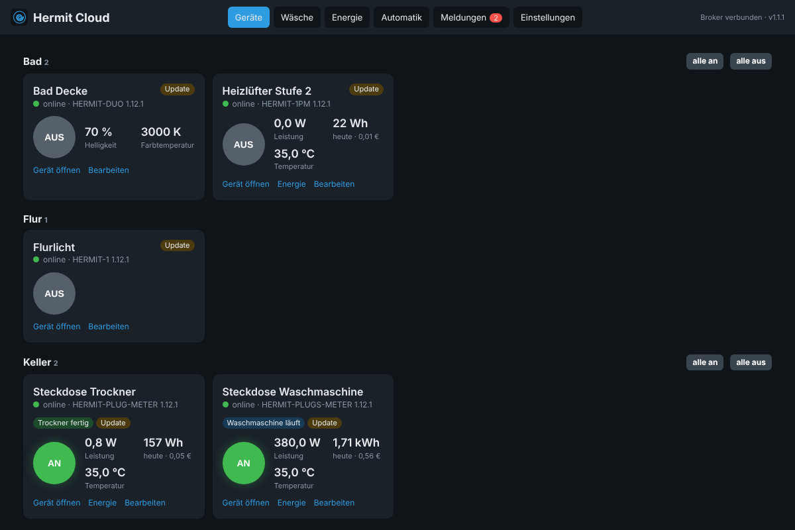

# Hermit OS 🐚

*Wie ein Einsiedlerkrebs, der in ein altes Schneckenhaus zieht: neues Leben für alte Shelly-Gehäuse.*

Hermit OS ist eine freie Firmware für **Shelly-Geräte der ersten Generation** (ESP8266, 2 MB Flash). Sie gibt
den alten Geräten die **RPC-API von Shelly Gen2/Gen3**: Scripte auf Plus-, Pro- und Gen3-Geräten sprechen ein
altes Shelly 1 genauso an wie ein neues – und die alten Geräte melden Ereignisse per Webhook zurück.
Alles läuft lokal; wer eine Übersicht will, nimmt die optionale **[Hermit Cloud](cloud/)** für zu Hause.

| Gerät | Firmware | Verhält sich wie | Besonderheiten |
|---|---|---|---|
| **Shelly 1** | `hermit-1` | Shelly Plus 1 (`switch:0`) | SW-Eingang für AC/DC, optional Add-on-Taster |
| **Shelly 1PM** | `hermit-1pm` | Shelly Plus 1PM | Wirkleistung, Energie, Temperatur, Schutzabschaltung, optional Add-on-Taster oder **Messfirmware** |
| **Shelly Plug S** | `hermit-plugs` | Shelly Plus Plug S | Leistung, **Spannung, Strom, cos φ**, Gerätetaster, zwei LEDs, optional **Messfirmware** |
| **Shelly Plug** (16 A, `SHPLG-1`/`SHPLG2-1`) | `hermit-plug` | Shelly Plus Plug S | Wirkleistung, Energie, Gerätetaster, LEDs, optional **Messfirmware** |
| **Shelly Duo** (E27/GU10, weiß) | `hermit-duo` | Shelly Duo Bulb Gen3 (`cct:0`) | Helligkeit, Farbtemperatur 2700–6500 K, Überblenden |

> Shelly ist eine Marke der Shelly Group. Hermit OS ist ein unabhängiges Projekt ohne Verbindung zum
> Hersteller. Benutzung auf eigene Gefahr – die Geräte arbeiten mit Netzspannung.

Varianten: `-addon` (Shelly-Temperatur-Add-on als externer Taster) und `-meter` (**Messfirmware**: nur
Energiemessung, Relais bleibt an, Reset nach Überlast nur am Gerät).

---

## Funktionen

- **Gen2-RPC über HTTP:** `GET /rpc/Switch.Set?id=0&on=true` und `POST /rpc` (JSON-RPC mit `id`, `src`, `dst`)
- **Statusfelder wie Gen2:** `output`, `source`, `timer_*`, `apower`, `voltage`, `current`, `pf`,
  `aenergy.total/by_minute`, `temperature.tC`, `errors`
- **Aktionen (Webhooks)** bei Schalten, Tastendruck, Leistungsschwellen, Überlast, Übertemperatur und Start –
  mit Platzhaltern wie `${apower}` in der URL
- **Weboberfläche auf Deutsch:** Status, Schalter/Licht, Aktionen, WLAN, System, RPC-Konsole
- **MQTT im Gen2-Format** (optional) – für die **[Hermit Cloud](cloud/)**, Home Assistant oder Node-RED
- **Auto-Update** aus diesem Repo (`update.json`), SHA-256-geprüft, Relais bleibt beim Neustart im Zustand
- **WLAN und feste IP werden übernommen** – aus der Original-Firmware, aus Tasmota oder vom Hermit Loader
- **Gen1-kompatibel:** `/relay/0`, `/light/0`, `/status`, `/meter/0`, `/shelly`
- **Zugangspunkt** `hermit-…` auf **192.168.33.1** mit Captive-Portal, falls kein WLAN erreichbar ist
- **mDNS** `hermit-<modell>-<mac>.local`, Dienst `_shelly._tcp`
- **Passwortschutz** optional (Benutzer `admin`, Digest oder Basic)
- **Kalibrierung pro Gerät**, bleibt auch bei Werkseinstellungen erhalten
- **MQTT im Gen2-Format** (optional) – für die Hermit Cloud, Home Assistant oder Node-RED

## Download

- **Fertige Pakete** je Modell (Firmware, Flasher, Anleitung): **[Releases](https://github.com/oeltensack/hermit-os/releases)**
- **Einzelne Firmware-Dateien:** Ordner **[bin/](bin/)** – immer die aktuelle Version
- **Hermit Cloud:** Ordner **[cloud/](cloud/)**

## Schnellstart

1. Paket für dein Modell nehmen: `Hermit-OS-<version>-Shelly-<Modell>.zip`
2. Entpacken, Doppelklick auf **`Hermit-Flasher.pyw`** (Python 3 für Windows nötig – oder einmal
   `tools\build_exe.bat` ausführen und danach `Hermit-Flasher.exe` nutzen)
3. **Netz durchsuchen** → Gerät wählen → **Hermit OS installieren**

Der Flasher erkennt selbst, ob auf dem Gerät die Original-Firmware, Tasmota, der Hermit Loader oder schon
Hermit OS läuft, und wählt den passenden Weg. Alles Weitere: **[docs/FLASHEN.md](docs/FLASHEN.md)**

Danach ist das Gerät unter `http://<ip>/` erreichbar (deutsche Oberfläche) und aktualisiert sich auf Wunsch
selbst aus diesem Repo.

## Zusammenspiel mit Gen2/Gen3

```js
// altes Shelly 1 schalten
Shelly.call("HTTP.GET", { url: "http://192.168.0.50/rpc/Switch.Set?id=0&on=true" });

// Leistung eines alten 1PM lesen
Shelly.call("HTTP.GET", { url: "http://192.168.0.51/rpc/Switch.GetStatus?id=0" }, function (r) {
  let st = JSON.parse(r.body);          // st.output, st.apower, st.aenergy.total, st.temperature.tC
});

// Duo dimmen und warmweiß stellen
Shelly.call("HTTP.GET", { url: "http://192.168.0.70/rpc/CCT.Set?id=0&on=true&brightness=40&ct=2700" });
```

**Rückweg:** Im alten Gerät eine *Aktion* anlegen – z. B. Ereignis `input.toggle_on` →
`http://<gen2-ip>/rpc/Switch.Set?id=0&on=true`, oder an einen Script-Endpunkt
`http://<gen2-ip>/script/1/alt?ev=${event}&p=${apower}`. Fertige Scripte: **[examples/](examples/)**

## Hermit Cloud (optional)

Eine kleine Heim-Cloud als Docker-Paket (Mosquitto + Weboberfläche), z. B. auf Proxmox, einem Raspberry Pi
oder NAS: Geräte nach Räumen, **Wäsche** (Waschmaschine/Trockner mit Fertig-Meldung und Restzeit), Energie mit
**Kosten**, Grundlast und CSV-Export, **Zeitpläne und Regeln**, Meldungen mit **Push** (ntfy/Telegram),
Firmware-Updates für alle Geräte, Sicherung der Geräte-Einstellungen, Benutzer mit Rollen – auch als App
auf dem Handy. Die Geräte verbinden sich per **MQTT im
Gen2-Format** – damit klappen auch Home Assistant und Node-RED. Shelly Plus/Pro werden ebenfalls angezeigt.



Einrichtung: **[cloud/README.md](cloud/README.md)**

## Dokumentation

| Dokument | Inhalt |
|---|---|
| **[docs/FLASHEN.md](docs/FLASHEN.md)** | Flasher (grafisch, Konsole, EXE), Wege von Original-Firmware und Tasmota, Hermit Loader, serielles Flashen, Updates, Fehlersuche |
| **[docs/GERAETE.md](docs/GERAETE.md)** | Pinbelegung, Eingänge, Messung und Kalibrierung, LEDs, WLAN-Reset, Add-on, Plug S, Duo |
| **[docs/API.md](docs/API.md)** | Alle RPC-Methoden, Statusfelder, Aktionen und Platzhalter, Gen1-Endpunkte, Diagnose, Unterschiede zu Gen2 |
| **[cloud/](cloud/README.md)** | Hermit Cloud: Heim-Cloud mit Übersicht, Schalten, Energieverlauf und Meldungen (Docker) |
| **[CHANGELOG.md](CHANGELOG.md)** | Versionsverlauf |
| **[examples/](examples/)** | Gen2-Scripte, u. a. Heizlüfter-Stufe 2 am 1PM mit Watchdog |

## Projektaufbau

```
src/                 Firmware: main.cpp, webui.h, device.h, tasmota_import.h, mgos_import.h, loader.cpp
bin/                 fertige Firmware (.bin, .bin.gz) und Hermit Loader
tools/               hermit_flash.py (Konsole), hermit_flash_gui.py (Oberfläche), build_exe.bat, make_release.py
examples/            Gen2/Gen3-Scripte
cloud/               Hermit Cloud (Docker: Mosquitto + Weboberfläche)
docs/                Dokumentation
update.json          Versionsliste für das Auto-Update
Hermit-Flasher.pyw   Startdatei für den grafischen Flasher
```

## Selbst bauen

```bash
pip install platformio
pio run                          # alle Varianten und den Loader bauen
python3 tools/make_release.py    # bauen, bin/ füllen, update.json schreiben, dist/*.zip packen
```

PlatformIO-Umgebungen: `shelly1`, `shelly1pm`, `shelly1_addon`, `shelly1pm_addon`, `plugs`, `plug`, `duo`, `shelly1pm_meter`, `plugs_meter`, `plug_meter`, `loader`.
Flash-Layout 2 MB (`eagle.flash.2m256`): ca. 1,7 MB für Firmware und OTA, 236 KB LittleFS.

**Neue Version veröffentlichen:** Version in `platformio.ini` erhöhen → `python3 tools/make_release.py` →
committen und pushen. Die Geräte finden die neue Version über `update.json`.

## Grenzen

- Kein WebSocket-RPC, keine Shelly-Cloud, keine Shelly-App. Die Shelly-Integration von Home Assistant
  erwartet bei Gen2 einen WebSocket und funktioniert deshalb nicht – dort MQTT oder REST nutzen.
- MQTT ohne TLS (zu wenig RAM) – im eigenen Netz oder über VPN betreiben.
- Keine Scripte auf dem Gerät selbst (der ESP8266 hat dafür zu wenig RAM). Die Logik liegt auf dem Gen2/Gen3.
- Shelly Duo RGBW und andere Gen1-Modelle werden noch nicht unterstützt.

## Lizenz

Copyright (C) 2026 D.Koch

Hermit OS ist freie Software: Du kannst es unter den Bedingungen der **GNU General Public License**, wie von
der Free Software Foundation veröffentlicht, weitergeben und/oder verändern – entweder gemäß **Version 3**
der Lizenz oder (nach deiner Wahl) jeder späteren Version (`GPL-3.0-or-later`).

Hermit OS wird in der Hoffnung verbreitet, dass es nützlich ist, aber **ohne jede Gewährleistung** – sogar
ohne die implizite Gewährleistung der Marktfähigkeit oder der Eignung für einen bestimmten Zweck.
Den vollständigen Lizenztext enthält [LICENSE](LICENSE).

Verwendete Bibliotheken: ESP8266-Arduino-Core (LGPL-2.1), ArduinoJson (MIT), PubSubClient (MIT).
Hermit Cloud: FastAPI (MIT), Uvicorn (BSD), paho-mqtt (EPL-2.0/EDL-1.0), Eclipse Mosquitto (EPL-2.0/EDL-1.0).

## Mitmachen

Fehler, Wünsche und Erfahrungen mit weiteren Gen1-Modellen gern als
**[Issue](https://github.com/oeltensack/hermit-os/issues)**. Hilfreich ist dabei die Ausgabe von
`http://<ip>/rpc/Shelly.GetDeviceInfo` und `http://<ip>/rpc/Shelly.GetStatus`.
Pull Requests sind willkommen – bitte mit `pio run` bauen und am Gerät testen.

## English summary

Hermit OS is a free replacement firmware for first-generation **Shelly devices** (Shelly 1, 1PM, Plug,
Plug S, Duo – ESP8266, 2 MB). It exposes the **Shelly Gen2/Gen3 RPC API** (`/rpc/Switch.Set`, `Switch.GetStatus`,
webhooks, Gen2-style MQTT), so Gen2/Gen3 scripts can control old devices like new ones. It can be flashed
over the air from the stock firmware or Tasmota with the included flasher, updates itself from this
repository, and comes with an optional self-hosted **Hermit Cloud** (Docker). UI and docs are in German.

## Danke

- **Tasmota** – Pinbelegungen, BL0937-Formeln und das Einstellungsformat, auf dem der WLAN-Import beruht
- **mgos-to-tasmota** (Mark Dornbach, GPL-3.0) – der Flasher lädt es und ändert nur die Download-Adresse
  („mg2hermit“), um von der Original-Firmware direkt zu Hermit OS zu wechseln
- **ESPHome**-Gerätedatenbank – Pinbelegung der Duo
