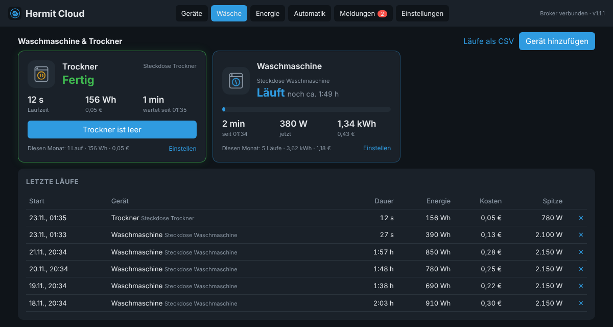

# Hermit Cloud

Kleine Heim-Cloud für Hermit-OS-Geräte (und Shelly Plus/Pro Gen2/Gen3). Läuft zu Hause als
Docker-Paket. Sie ist **optional**: Die Geräte arbeiten ohne sie genauso, die Cloud liest nur mit.

**Funktionen**
- **Geräte nach Räumen**, Schalten einzeln oder „alle an/aus“ je Raum, Energie und Kosten von heute
- **Wäsche:** Waschmaschine und Trockner mit Fertig-Erkennung – läuft/fertig, Restzeit aus früheren Läufen,
  Energie und Kosten je Lauf, Push „fertig“ und Erinnerung, wenn nicht ausgeräumt wird. Dazu Spülmaschine
  und beliebige Geräte (z. B. Akkuladegerät) mit Fertig-Meldung
- **Energie:** Leistungsverlauf 6 h bis 30 Tage mit Spitzenwerten und Zoom, Energie pro Tag/Monat mit Kosten,
  Verbrauch je Gerät, **Grundlast/Standby** mit Kosten pro Jahr, **CSV-Export** für Excel
- **Automatik:** Zeitpläne (Uhrzeit oder Sonnenauf-/untergang ± Minuten, Wochentage, Gerät oder Raum) und
  **Regeln** (Wenn Leistung/Schalter/Ereignis/offline/fertig/URL-Aufruf → schalten, verzögert, automatisch
  wieder aus, Push), mit Zeitfenster
- **Meldungen** mit **Push** über ntfy oder Telegram
- **Firmware-Übersicht** mit Update einzeln oder für alle Geräte
- **Sicherung** der Geräte-Einstellungen (nachts automatisch) und Zurückspielen, auch auf ein Ersatzgerät
- **Benutzer** mit Rollen (Administrator, Benutzer, Betrachter)
- **Handy:** als App auf dem Startbildschirm (PWA)
- **Selbst-Update** aus diesem Repo



```
Hermit-Geräte ──MQTT (Gen2-Format)──►  Mosquitto :1883  ◄──►  Hermit Cloud :8080  ──► Browser
```

## Installation auf Proxmox

Am einfachsten ein Debian-12-LXC-Container (1 CPU, 512 MB RAM, 4 GB Disk). Für Docker im LXC unter
*Optionen → Features* **Nesting** einschalten.

```bash
# im Container
apt update && apt install -y curl git
curl -fsSL https://get.docker.com | sh        # Docker inkl. „docker compose“
git clone https://github.com/oeltensack/hermit-os.git
cd hermit-os/cloud
cp .env.example .env
nano .env          # MQTT_USER, MQTT_PASS, CLOUD_PASSWORD, PUBLIC_BROKER (IP des Containers)
docker compose up -d
```

Weboberfläche: `http://<IP-des-Containers>:8080`

Alternativ geht jeder Rechner mit Docker (VM, Raspberry Pi, NAS).

## Geräte verbinden

**Hermit OS** (ab 1.12.0): Geräteoberfläche → *System* → *Cloud / MQTT*
- Haken „MQTT einschalten“
- Server: `<IP-des-Containers>:1883`
- Benutzer/Passwort: `MQTT_USER` / `MQTT_PASS` aus der `.env`
- Topic-Präfix leer lassen (= Geräte-ID)

**Shelly Plus/Pro**: *Einstellungen → MQTT*, gleicher Server und Zugang,
„RPC status notifications over MQTT“ und „Generic status update over MQTT“ einschalten.

Die Geräte erscheinen automatisch, sobald sie verbunden sind.

## Update

Die Cloud aktualisiert sich selbst. Unter **Info → Cloud-Update**:

| Modus | Verhalten |
|---|---|
| Aus | keine Prüfung |
| Nur prüfen | alle 6 h prüfen, Hinweis oben rechts, Installation mit **Jetzt aktualisieren** |
| Automatisch installieren (Standard) | zusätzlich täglich zur eingestellten Stunde installieren |

Installiert wird vom Container `hermit-cloud-updater`: Er holt den neuen Stand (`git pull`, bei
entpacktem ZIP das Archiv von GitHub), baut die Container neu und startet sie. Die Oberfläche ist dabei
etwa eine Minute weg und lädt danach von selbst neu. Das Protokoll steht unter Info.

- `docker compose` immer **im Ordner `cloud/`** starten – der Updater merkt sich diesen Pfad.
- Der Updater braucht Zugriff auf `/var/run/docker.sock` und den Repo-Ordner. Wer das nicht will, nimmt den
  Dienst `updater` aus der `docker-compose.yml` und aktualisiert von Hand:
  `cd hermit-os && git pull && cd cloud && docker compose up -d --build`
- Wer die Cloud aus dem ZIP installiert hat: in einem eigenen Ordner entpacken (z. B. `/opt/hermit/cloud`).

**Von 1.0.x auf 1.1.0** einmal von Hand (danach geht es automatisch):
```bash
cd hermit-os && git pull && cd cloud && docker compose up -d --build
```

Die Daten liegen in `cloud/data/cloud.db` (SQLite) und bleiben beim Update erhalten.
Sicherung: den Ordner `data/` kopieren.

## Einstellungen (.env)

| Variable | Bedeutung |
|---|---|
| `MQTT_USER`, `MQTT_PASS` | Zugang zum Broker für Geräte und Cloud (leer = Broker ohne Anmeldung) |
| `CLOUD_PASSWORD` | Passwort des Benutzers `admin` (leer und keine Benutzer = ohne Anmeldung) |
| `PUBLIC_BROKER` | IP des Rechners, wird in der Oberfläche unter *Info* angezeigt |
| `WEB_PORT` | Port der Weboberfläche (Standard 8080) |
| `TZ` | Zeitzone für die Tageswerte |

Weitere Werte im Container: `KEEP_POWER_DAYS` (Leistungsverlauf, Standard 31 Tage),
`OFFLINE_AFTER` (s ohne Lebenszeichen bis „offline“, Standard 180).

Ein abgezogenes Gerät meldet der Broker nach etwa 45 s (Hermit OS ab 1.12.2) als offline; spätestens nach
`OFFLINE_AFTER` setzt die Cloud es selbst auf offline. Offline-Geräte bleiben mit ihren Werten in der Liste,
bis du sie mit **Entfernen** löschst.

## Erste Schritte

1. **Einstellungen → Strom & Standort:** Strompreis in ct/kWh, Breiten-/Längengrad (für Sonnenzeiten) und die
   Adresse der Cloud (z. B. `http://192.168.0.50:8080`, für URL-Auslöser).
2. **Einstellungen → Push:** ntfy oder Telegram eintragen, **Testnachricht** senden.
3. **Geräte → Bearbeiten:** Name und Raum vergeben.
4. **Wäsche → Gerät hinzufügen:** die Messsteckdose der Waschmaschine bzw. des Trockners zuordnen.
   Die Vorgaben passen für die meisten Geräte; nach ein paar Läufen zeigt die Cloud auch die Restzeit.

**Push über ntfy:** App „ntfy“ installieren, ein langes, zufälliges Thema abonnieren (z. B.
`hermit-k7f3q9x2`) und in der Cloud `https://ntfy.sh/hermit-k7f3q9x2` eintragen. Wer nichts über ntfy.sh
schicken will, startet den eigenen ntfy-Server mit `docker compose --profile ntfy up -d` und trägt
`http://<IP>:8090/<thema>` ein (Server in der App hinzufügen).

**Push über Telegram:** Bei @BotFather einen Bot anlegen (Token), dem Bot schreiben, die Chat-ID z. B. über
`https://api.telegram.org/bot<TOKEN>/getUpdates` ablesen.

**Tür-/Fensterkontakt (z. B. Shelly Door/Window 2):** Regel mit Auslöser „URL-Aufruf“ anlegen, die angezeigte
URL am Kontakt unter *Actions → Open* eintragen. Beispiel: Fenster auf → Raum Bad ausschalten.

**Benutzer:** Der Administrator `admin` kommt aus `CLOUD_PASSWORD`. Weitere Benutzer unter Einstellungen;
ändert man dort das admin-Passwort, gilt ab dann dieses (die `.env` wird dann ignoriert).

## Von unterwegs

Nicht direkt ins Internet stellen. Am besten über den WireGuard-Tunnel ins Heimnetz
oder über einen Reverse-Proxy mit HTTPS und gesetztem `CLOUD_PASSWORD`.

## Schnittstelle

| Methode | Pfad | |
|---|---|---|
| GET | `/api/devices` | alle Geräte mit Status und Energie heute |
| POST | `/api/devices/{id}/switch` | `{}` umschalten, `{"on":true}` setzen |
| POST | `/api/devices/{id}/rpc` | `{"method":"Switch.GetStatus","params":{"id":0}}` beliebige RPC |
| POST | `/api/devices/{id}/name` | `{"name":"…"}` |
| DELETE | `/api/devices/{id}` | Gerät und gespeicherte Werte entfernen |
| GET | `/api/devices/{id}/power?hours=24` | Leistung je Minute |
| GET | `/api/energy?dev=…&days=31` | Energie pro Tag (ohne `dev`: alle) |
| GET | `/api/energy/months?dev=…` | Energie pro Monat |
| GET | `/api/energy/by_device?days=30` | Verbrauch je Gerät |
| GET | `/api/alerts` · POST `/api/alerts/ack` | Meldungen, `{"id":…}` oder alle quittieren |
